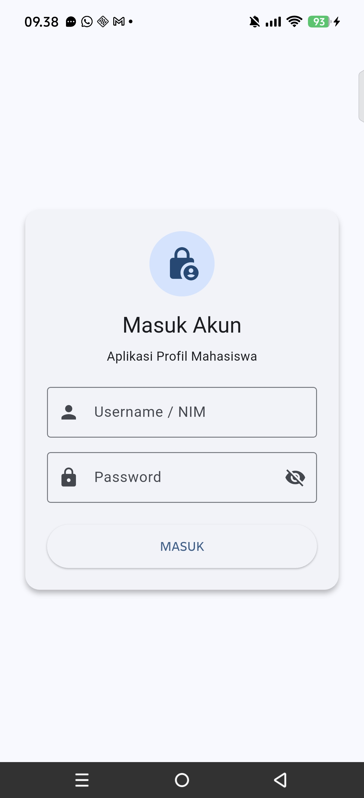
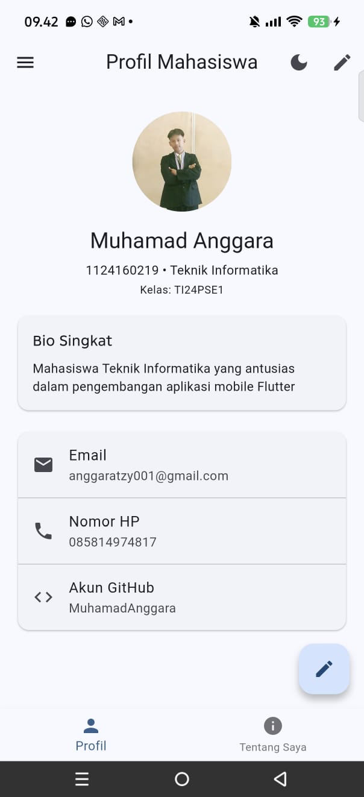
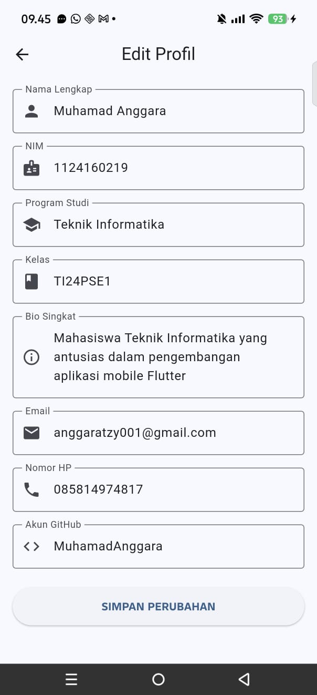

# UTS Praktikum Pemrograman Mobile (PML) - Soal 2
## Aplikasi Profil Mahasiswa

Aplikasi profil diri mahasiswa berbasis Android yang dibangun menggunakan Flutter framework.

---

### Identitas Mahasiswa
- **Nama Lengkap:** Muhamad Anggara
- **Nama Panggilan:** Anggara
- **NIM:** 1124160219
- **Program Studi:** Teknik Informatika
- **Kelas:** TI24PSE1
- **Repository GitHub:** [https://github.com/MuhamadAnggara/uts-pml-1124160219](https://github.com/MuhamadAnggara/uts-pml-1124160219)
- **Link Video YouTube:** [Tonton Video Presentasi di YouTube](https://youtu.be/) *(Menyusul)*

---

### Screenshot Aplikasi

| Halaman Login | Halaman Profil | Halaman Edit Profil |
| :---: | :---: | :---: |
|  |  |  |

---

### Daftar Fitur Utama
1. **Halaman Login (Materi 5):**
   - Menggunakan `StatefulWidget`, `Form`, dan `TextFormField` dengan validator.
   - Indikator loading saat proses login.
   - Navigasi menggunakan `Navigator.pushReplacementNamed`.

2. **Halaman Profil Mahasiswa:**
   - Foto profil diri dari folder `assets/images/profile.png` (terdaftar di `pubspec.yaml`) ditampilkan dengan `CircleAvatar`.
   - Data profil lengkap: Nama lengkap, NIM, program studi, kelas, dan bio singkat.
   - Kontak (email, nomor HP, akun GitHub) menggunakan `Card` dan `ListTile` berikon.

3. **Halaman Edit Profil:**
   - Form otomatis terisi dengan data profil saat ini (`TextEditingController`).
   - Validasi ketat: nama wajib diisi, format email valid, nomor HP hanya angka 10–13 digit.
   - Tombol Simpan kembali ke Halaman Profil menggunakan `Navigator.pop(context, dataBaru)`.
   - Halaman Profil langsung menampilkan data baru secara real-time menggunakan `setState()`.

4. **Halaman Tentang Saya:**
   - Menampilkan minimal 3 keahlian teknis dan riwayat pendidikan menggunakan `ListView`.

5. **Komponen Scaffold Lengkap:**
   - AppBar interaktif, Navigation Drawer di kiri, BottomNavigationBar di bawah, dan FloatingActionButton untuk edit profil.

6. **Tema Terang & Gelap (Dynamic ThemeMode):**
   - Mendukung `theme` (Light Mode) dan `darkTheme` (Dark Mode).
   - Tombol / switch di dalam aplikasi yang mengubah `themeMode` secara langsung.

7. **Identitas Native Android:**
   - Nama aplikasi di HP Android diganti menjadi **`Profil Anggara`** via atribut `android:label` pada `AndroidManifest.xml`.

---

### Cara Menjalankan Aplikasi
1. Buka terminal pada folder proyek `soal2_profile_app`.
2. Unduh paket dependensi:
   ```bash
   flutter pub get
   ```
3. Jalankan aplikasi pada perangkat Android:
   ```bash
   flutter run
   ```